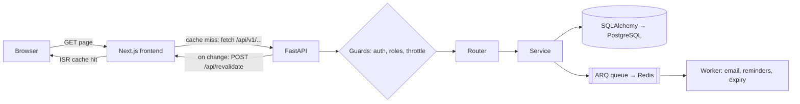
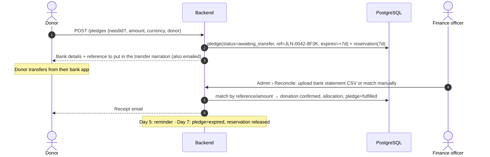
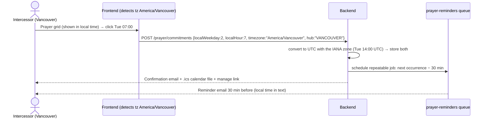
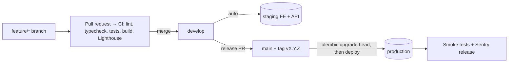

# 03 · Technical Flow

How data moves between the browser, the frontend (Next.js), the backend (FastAPI), the database and outside services. Diagrams use Mermaid (they render on GitHub, in VS Code with a Mermaid extension, and in most Markdown viewers).

---

## 1. Request lifecycle



- Public pages come from the ISR cache. When a need, missionary or content block changes, the backend calls a **secret-protected revalidate endpoint** on the frontend, so progress bars update within seconds.
- The browser only calls the API directly for mutations (forms, giving, "I prayed") and for logged-in pages.

## 2. Contributory need gift: card / USSD (Paystack or Flutterwave)

```mermaid
sequenceDiagram
  autonumber
  actor D as Donor
  participant FE as Frontend
  participant API as Backend API
  participant DB as PostgreSQL
  participant GW as Gateway (Paystack/Flutterwave)
  participant Q as Jobs (ARQ)

  D->>FE: Need JLN-0042 → enter amount (or "Fund the remainder")
  FE->>API: POST /payments/checkout {needId, amount, currency, donor, frequency:"once"}
  API->>DB: BEGIN; SELECT need FOR UPDATE; compute available
  alt amount > available
    API-->>FE: 409 {available} → UI offers to give "available" (+ surplus to General Fund)
  else ok
    API->>DB: INSERT donation(pending), payment(initiated), need_reservation(TTL 30m); COMMIT
    API->>GW: initialize transaction (reference = JLP-…)
    GW-->>API: authorization_url
    API-->>FE: {redirectUrl}
    FE->>GW: redirect donor to hosted checkout
  end
  D->>GW: pays (card / USSD / transfer)
  GW-->>FE: redirect /give/thank-you?ref=… (shows "Confirming…")
  GW->>API: POST /webhooks/paystack (signed)
  API->>API: verify HMAC + call GW verify(ref)  (idempotent on event id)
  API->>DB: BEGIN; need FOR UPDATE; allocate min(amount, remaining) to need, rest → General Fund;<br/>payment=succeeded; donation=confirmed; release reservation; update need totals/status; COMMIT
  API->>Q: email receipt; if need funded → notify contributors + coordinator; revalidate need page
  FE->>API: poll GET /payments/:ref/status → "succeeded"
  FE-->>D: Thank-you page + share buttons
```

**Edge cases**

- Webhook arrives before the redirect: fine, because the thank-you page polls the status.
- Payment abandoned: the reservation expires after 30 min (job `need-reservation-expiry`) and the capacity is released.
- Two donors both press "Fund the remainder": the row lock lets the first through. The second is either blocked at checkout (409) or, if both were already paid, has their surplus sent to the General Fund and is told so in the receipt.

## 3. Bank-transfer pledge (Angel Tree style)



## 4. Recurring partnership (Adopt-a-Missionary tiers)

1. `POST /recurring` → backend creates a `recurring_gift` (pending) and a gateway **plan + subscription** (Paystack Plans for NGN, Flutterwave Payment Plans for other currencies).
2. First charge is confirmed by webhook → `recurring_gift=active`, `next_charge_at` set.
3. Every later charge arrives by webhook (`charge.success` / `subscription.*`) → new `donation` linked to the recurring gift, allocated to the missionary's monthly support.
4. Failure (`invoice.payment_failed`) → `past_due`, email with a card-update link. After 3 failures → `lapsed`, and the field coordinator is told.
5. A partner manages the gift through a magic link or their account: change amount, pause, or cancel (which calls the gateway's disable-subscription API).
6. Nightly `recurring-sync` job checks our state against the gateway.

## 5. Need lifecycle (operations)

```mermaid
flowchart TD
  A[Coordinator drafts need<br/>+ photos (EXIF stripped)] --> B[Submit → in_review]
  B --> C{Admin approves?}
  C -- no --> A
  C -- yes --> D[open · public · code JLN-xxxx]
  D --> E[gifts / pledges → partially_funded]
  E --> F{target met?}
  F -- yes --> G[funded → notify contributors + finance]
  F -- deadline passed --> H[expired → staff choose: extend / close partial / reallocate]
  G --> I[Finance pays missionary → disbursed (proof upload)]
  I --> J[Coordinator posts fulfilment update → fulfilled → email all contributors]
```

Daily job `need-deadlines` (06:00 WAT): marks expired needs, sends "3 days left" nudges to past contributors in that category (opt-in), and creates a task for the coordinator.

## 6. Prayer slots across four time zones

**Storage rule:** a weekly slot is stored as `(weekday_utc 0–6, hour_utc 0–23)` **plus** the intercessor's `hub` / IANA `timezone`.

The catch is that daylight saving moves *local* times against UTC. A Vancouver intercessor who signs up for "Tuesday 7 am local" expects 7 am local all year round. So:

- The slot is anchored to **local wall-clock time**: `local_weekday`, `local_hour`, `timezone`.
- The UTC position (`weekday_utc`, `hour_utc`) is **derived** and recomputed by a job twice a year when DST changes (`prayer-dst-rebalance`, which runs daily and only acts on change days). The coverage grid always reads the derived UTC values.



**Global Prayer Clock (frontend only):** every second, compute the time in the 4 zones with `Intl.DateTimeFormat`, find the active watch from `settings.prayer_watches` (UTC windows), and show the countdown to the next handover. No API call is needed except the windows (cached).

**"I prayed for this":** `POST /prayer/requests/:id/prayed`. Limited by a device fingerprint cookie + IP to one per 24 h. The counter is incremented in Redis and flushed to Postgres every minute.

## 7. Media upload

Admin picks a file → `POST /media/sign` → the backend returns a signed Cloudinary upload (with the `strip metadata` transformation) → the browser uploads directly → `POST /media` saves the record (`public_id`, alt text, sensitive flag). Sensitive images are served with blur or not at all on public pages.

## 8. Notifications pipeline

Domain event (e.g. `need.funded`) → `NotificationsService.dispatch()` → find recipients and their preferences → enqueue `email` jobs (template + data) → worker renders React Email → provider API → log in `notifications` (status, provider id). Retries with exponential backoff (5 tries), then goes to a dead-letter list shown in admin.

## 9. Deployment pipeline



Database migrations always run **before** the new API version starts and must be backward compatible (expand → migrate → contract).
