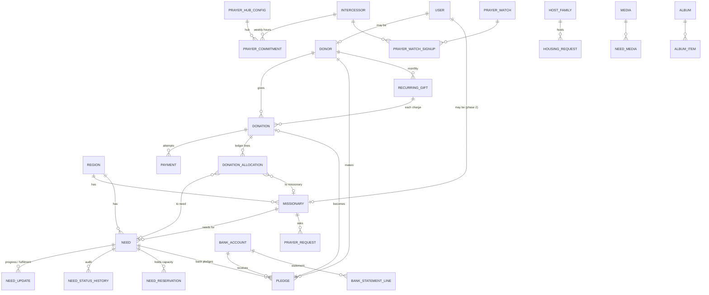

# 06 · Database Design

**Engine:** PostgreSQL 16 (SQLite for local dev and tests) · **ORM / migrations:** SQLAlchemy 2 + Alembic
**Source of truth:** the models in [`backend/app/models/`](../backend/app/models/) and the migrations in [`backend/alembic/versions/`](../backend/alembic/versions/). This document explains them. If they disagree, the code wins.

---

## 1. Conventions

| Rule | Detail |
|------|--------|
| IDs | UUID4 hex strings. Public, human codes are separate (`JLN-0042`, `JLD-2027-000123`, `JLH-0007`, pledge `JLN-0042-8F3K`) |
| Money | `BigInt` minor units + `Currency` enum. **No floats anywhere.** FX rates are `Decimal(18,8)` |
| Time | `timestamptz`, always UTC. Prayer local times are stored as `(localWeekday, localHour, timezone)` |
| Naming | Python classes in PascalCase → tables in snake_case plural (`__tablename__`). Columns snake_case in the DB, camelCase in the JSON API |
| Deletes | Financial rows are never deleted (append-only ledger). People are soft-deleted / anonymised (`deletedAt`) |
| Encryption | Columns ending `_enc` are AES-256-GCM encrypted by the app (`backend/app/core/security.py`) |
| Totals | `needs.raisedMinor / reservedMinor / contributorCount` are denormalised for fast listing, updated **in the same transaction** as allocations, and rebuilt nightly by a check job |

## 2. Entity-relationship overview



## 3. Table groups

| Group | Tables | Purpose |
|-------|--------|---------|
| Identity | `users`, `refresh_tokens`, `magic_links` | Accounts, sessions, passwordless links |
| Givers | `donors` | Every giver, with or without an account |
| Field | `regions`, `missionaries` | Directory; sensitive fields encrypted |
| Needs | `needs`, `need_media`, `need_updates`, `need_status_history`, `need_reservations` | Contributory Needs Board |
| Money | `donations`, `donation_allocations`, `payments`, `webhook_events`, `pledges`, `bank_accounts`, `bank_statement_lines`, `recurring_gifts`, `partner_tier_prices`, `fx_rates` | Giving, ledger, reconciliation |
| Prayer | `prayer_hub_configs`, `intercessors`, `prayer_commitments`, `prayer_watches`, `prayer_watch_signups`, `prayer_requests` | 4-hub prayer network |
| Housing | `host_families`, `housing_requests` | Transit housing |
| Content | `media`, `albums`, `album_items`, `reports`, `content_blocks`, `settings`, `contact_messages` | CMS-lite |
| Ops | `notifications`, `audit_logs` | Delivery log, staff audit |

## 4. Key queries and the indexes behind them

| Query | Index |
|-------|-------|
| Needs board: open needs by category/region, sorted by deadline | `needs(status, deadlineAt)`, `needs(category, status)`, `needs(regionId, status)` |
| Available capacity for a need | `need_reservations(needId, releasedAt, expiresAt)` |
| Contributors of a need | `donation_allocations(needId)` → join `donations` → `donors` |
| Webhook idempotency | `payments UNIQUE(provider, providerReference)`, `webhook_events UNIQUE(provider, eventId)` |
| Pledges to expire / remind | `pledges(status, expiresAt)` |
| Prayer coverage heatmap | `prayer_commitments(weekdayUtc, hourUtc, isActive)`: `GROUP BY weekdayUtc, hourUtc` |
| Due recurring charges / lapses | `recurring_gifts(status, nextChargeAt)` |

**Coverage heatmap query**

```sql
SELECT weekday_utc, hour_utc, COUNT(*) AS intercessors
FROM prayer_commitments
WHERE is_active = true
GROUP BY weekday_utc, hour_utc;   -- 168 cells max; empty cells = gaps
```

**Available amount on a need (inside the confirm transaction)**

```sql
-- 1. lock the need row
SELECT target_minor, raised_minor FROM needs WHERE id = $1 FOR UPDATE;
-- 2. sum live reservations (excluding the one being confirmed)
SELECT COALESCE(SUM(amount_minor), 0) FROM need_reservations
WHERE need_id = $1 AND released_at IS NULL AND expires_at > now() AND id <> $2;
-- available = target_minor - raised_minor - reserved
```

(Columns are snake_case in the database, e.g. `target_minor`; the API exposes camelCase, e.g. `targetMinor`.)

## 5. Integrity rules enforced in the database

Already declared in the models (so Alembic creates them): `needs` target > 0 and raised ≤ target; prayer weekday/hour ranges (local and UTC); housing `depart_on >= arrive_on`; unique `(provider, provider_reference)` on payments; unique `(provider, event_id)` on webhook events.

Still to add in a hand-written migration (Sprints 3–4):

```sql
-- One active commitment per intercessor per local hour (partial unique index; PostgreSQL)
CREATE UNIQUE INDEX pc_unique_active ON prayer_commitments (intercessor_id, local_weekday, local_hour) WHERE is_active;
-- Ledger is append-only for the app's DB role
REVOKE UPDATE, DELETE ON donation_allocations FROM app_user;
```

`needs_raised_le_target` is the last line of defence against over-funding. Surplus always goes to a `GENERAL_FUND` allocation row, never to the need.

## 6. Seed data (`backend/app/seed.py`)

| Table | Seed |
|-------|------|
| `prayer_hub_configs` | SYDNEY `Australia/Sydney` 0–360 · LAGOS `Africa/Lagos` 360–720 · NEW_YORK `America/New_York` 720–1080 · VANCOUVER `America/Vancouver` 1080–1440 (minutes UTC) |
| `regions` | West Africa · Sahel / Northern Frontier · East Africa · Liberia & Coast · Unreached Territories |
| `partner_tier_prices` | BRONZE NGN 1,500,000 kobo / USD 2,000 cents · SILVER NGN 5,000,000 / USD 6,500 · GOLD NGN 15,000,000 / USD 20,000 (+ GBP/EUR/CAD/AUD when confirmed) |
| `settings` | `needs.pledge_ttl_days=7`, `needs.checkout_ttl_minutes=30`, `needs.min_gift={NGN:100000,USD:500}`, `prayer.reminder_minutes=30`, `needs.code_prefix="JLN"` |
| `users` | One SUPER_ADMIN (from env `SEED_ADMIN_EMAIL`) |
| `content_blocks` | Placeholder hero, impact stats, money breakdown, FAQ |

## 7. Backups, retention and migrations

- Managed Postgres with **daily snapshots (30 days)** + point-in-time recovery. Monthly restore test into staging.
- `alembic revision --autogenerate` locally (always review the file) → committed → `alembic upgrade head` in CI before the app starts.
- Expand → migrate → contract for breaking changes. Never rename a column in one step.
- Retention job (monthly): delete `contact_messages` > 2 years, `magic_links` > 30 days, `webhook_events` payloads > 1 year (keep the row, drop the payload). Donations are kept 7 years.
